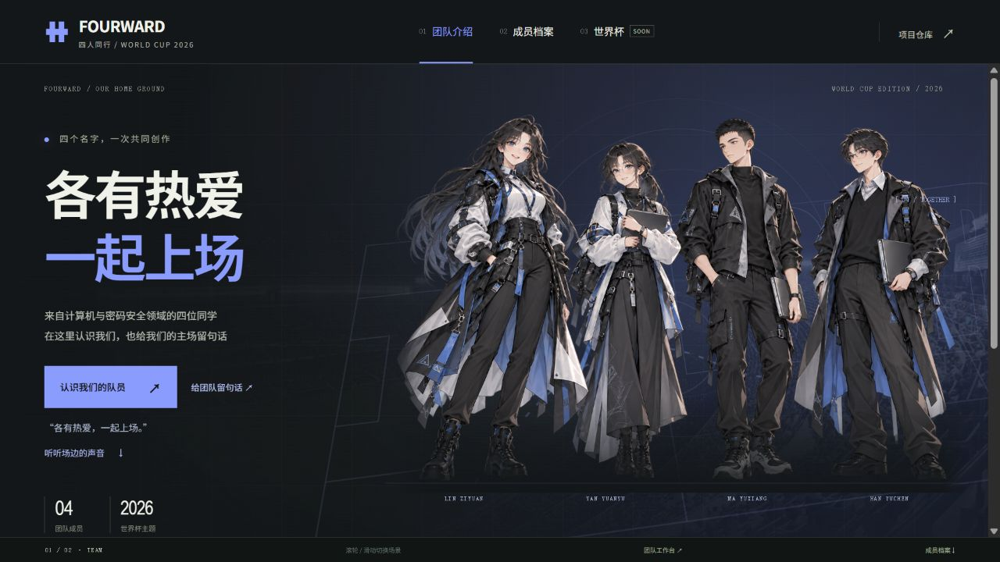
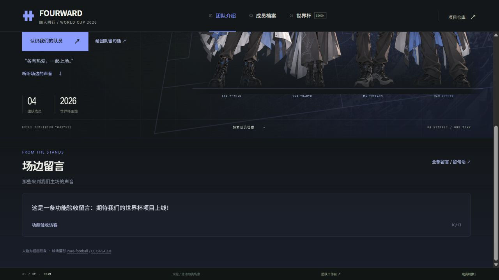

# 2026 世界杯课程设计

互联网数据库开发小组作业，包含团队主页和世界杯两个模块。

在线展示：[NKDEV · FOURWARD](https://acobayashi.github.io/WorldCup2026DB/)。代码协作：[GitHub 仓库](https://github.com/ACobayashi/WorldCup2026DB)。推送到 `main` 后，GitHub Actions 从已提交资料构建世界杯只读快照、执行检查，再发布 `public/` 到 GitHub Pages；也可在 Actions 中手动运行。Pages 不运行 PHP 或数据库；更新发布流程尚需推送后验证。

## 完整留言模块本地运行

已经实现访客留言和团队座右铭的 PHP MVC 功能链。访客可给整个团队或某位成员留言，留言写入数据库并默认为待审核，管理员通过后才公开；团队成员登录后可维护自己的座右铭，管理员还可维护团队及所有成员的座右铭。

在仓库根目录执行以下 PowerShell 命令。需要已有 XAMPP，包含 PHP 8.2+、PDO MySQL、mbstring 和 MariaDB 的 Windows 初始化工具。本机实际验证使用 E:\XAMPP 的 PHP 8.2.12 / MariaDB 10.4.32；这不是生产部署命令。

```powershell
powershell -ExecutionPolicy Bypass -File scripts/start-local.ps1 -XamppRoot E:\XAMPP
```

打开 http://127.0.0.1:8088/ ，页面底部的“团队工作台”进入 http://127.0.0.1:8088/admin.php 。本地账号为严苑毓的 `yan-yuanyu`（管理员）及另外三位成员的 slug（成员）。随机密码保存在 `storage/local-accounts.txt`，只用于本地开发，已经从 Git 排除。四位成员的初始座右铭已按本人提供的内容更新，之后可在工作台维护；已存在的数据库不会被初始化脚本覆盖。

脚本使用独立的 `storage/runtime/mysql` 数据目录，数据库端口 3307，Web 端口 8088，均只监听 127.0.0.1。它不会使用已有 XAMPP 的数据目录。重复启动保留账号、留言和座右铭，首次生成的 `.env` 和本地密码文件也从 Git 排除。端口冲突会报错；已有自定义 `.env` 时先按下面的手动配置方式运行。

```powershell
powershell -ExecutionPolicy Bypass -File scripts/stop-local.ps1 -XamppRoot E:\XAMPP
```

正常停止后数据仍保留。换机器时带走代码及所需 SQL/数据备份，重新初始化本地环境；不要复制、提交或公开运行目录及密码文件。

## 手动使用团队数据库

工作台的“团队与成员资料”支持发布团队介绍，以及成员的简介、学院、分工、工作内容、标签和 GitHub 主页。管理员可编辑全部资料，普通成员只能编辑自己的资料。已有数据库先执行 `php scripts/install.php`，新增 `team_profiles`，保留原来的账号、留言和座右铭。静态预览仍使用仓库里的默认资料。

主页的“作业与源码下载”提供 GitHub 的源码 ZIP。PHP 版另提供登录后下载：成员仅可下载自己的作业，管理员可下载已提供的所有作业。将课程压缩包放在 `storage/course-downloads/<member-slug>/assignment-1.zip`（作业二、三对应 `assignment-2.zip`、`assignment-3.zip`）。没有文件就不显示下载链接。该目录不进 Git，也不随 GitHub Pages 发布；换服务器时需要单独交接文件。

复制 `.env.example` 为 `.env`，填写同一个逻辑数据库的 PDO MySQL DSN、账号、密码和至少 32 字符的随机 APP_KEY。依赖 PHP 8.2+、PDO MySQL、mbstring。先创建空数据库，再在仓库根目录执行：

```sh
php scripts/install.php
php -S 127.0.0.1:8088 -t public public/router.php
```

安装 SQL 使用 CREATE TABLE IF NOT EXISTS 和 INSERT IGNORE，不清空已存在的数据，也不覆盖座右铭；这是初始化脚本，后续结构变更仍需单独迁移。目前包含五张团队/公共表及十四张 `wc_` 表，共 19 张。全量世界杯基础数据通过独立 CLI 导入，不在初始化时预置；本站支持记录仍由用户操作产生。共享账号表只创建一套；之后选择团队统一框架时，保留模型和功能链，接入公共登录及路由。已有本地环境可执行 `php scripts/install.php` 补建新表。

创建账号需通过环境变量提供 12–72 字节密码；密码只保存为哈希，不写进安装 SQL：

```powershell
$env:ACCOUNT_PASSWORD = Read-Host '输入本地开发账号密码'
php scripts/create-user.php yan-yuanyu yan-yuanyu admin
Remove-Item Env:\ACCOUNT_PASSWORD
```

成员账号将最后一个参数改为 `member`，账号绑定实际成员 slug。网站根目录应为 `public/`；Apache 可使用其中的 DirectoryIndex 设置，其他服务器请优先指定 `index.php`。此版本采用轻量 PHP MVC 类，未选用第三方框架，尚未验证云端或 Docker 部署。

## 验证

主页与场边留言截图来自本地数据库模式；公开留言按现有审核数据展示。GitHub Pages 使用静态演示模式。





```sh
node scripts/check-prototype.mjs
node --check public/assets/js/app.mjs
node --check public/assets/js/guestbook.mjs
node scripts/check-worldcup-snapshot.mjs
php scripts/check-guestbook.php
php scripts/check-worldcup.php
```

数据库验收使用事务并最终回滚所有测试数据，覆盖审核可见性、分页、Unicode 长度、文本转义、参数化 SQL、CSRF、角色权限、座右铭编辑和数据库限频。在已初始化的开发数据库上执行。访客留言每个 IP 每分钟窗口最多尝试 5 次，登录每个 IP 每 15 分钟窗口最多尝试 10 次；限频表存储带密钥的摘要，不存原始 IP，也不信任访客自报的代理头。

## 仅预览静态页面

```sh
python3 scripts/serve-prototype.py
```

打开 http://127.0.0.1:5173 。预览脚本需要 Node.js，会先从仓库数据生成世界杯快照；固定 .mjs 的 JavaScript 响应类型，避免 Windows 文件关联将其错误地识别成纯文本；不执行 PHP。运行 `node scripts/check-prototype.mjs` 和 `node scripts/check-worldcup-snapshot.mjs` 检查两个模块。

使用其他静态服务器时，先执行 `node scripts/build-worldcup-snapshot.mjs`，再以 `public/` 为网站根目录。生成的 `public/assets/data/worldcup-snapshot.json` 不进 Git，不包含账号、留言或支持记录；GitHub Actions 每次发布前离线重建，不访问数据源网站。

静态预览及 GitHub Pages 保留浏览器本地演示留言，明确标注为本地演示，不能跨浏览器共享，也不运行审核后台。使用 PHP 入口时则调用真实数据库接口，服务故障会显示失败并保留输入，不自动改为本地保存。页面保留独立场景转场、四人档案、人物入场和面部背景动效，成员卡片支持方向键。成员标签根据学院及分工整理，人物形象为插画。主页的“场边留言”展示最新三条团队留言，数据库模式只展示审核通过的内容；全部留言和分页保留在留言弹窗中。

静态预览和 GitHub Pages 的 `worldcup/index.html` 现在是世界杯只读资料入口：48 队完整名单、1,248 名球员、104 场赛程与比赛详情、首发阵型、技术统计与事件、球员赛事/单场面板、球员榜、球员/球队搜索对比、小组积分、第三名比较与淘汰赛晋级图。全部读取功能分支已提交的快照，不是实时赛事 API，也不连接共享数据库。缺失字段保留为 —；排名保留无法核实的并列。球队及球员对比支持两侧即时搜索，图表旁提供原始值表格。

原比分大屏和支持度演示移动到 `worldcup/demo.html`，资料入口保留直达链接。该页的对阵、时间、比分和票数仍均为合成示例，支持选择仅保存在浏览器；不与快照统计混用。静态版没有登录、个人支持、后台编辑或写入功能；这些边界仍由 PHP 入口处理。球员图片沿用已核对的外部图片地址，无法加载时回退到本地号码标记。

只读快照页面：[桌面截图](docs/screenshots/worldcup-snapshot-desktop.png)、[手机截图](docs/screenshots/worldcup-snapshot-mobile.png)。本地浏览器检查覆盖模块跳转、筛选分页、单场切换与刷新、对比搜索、晋级连线、原演示支持持久化、320/390px 布局、Pages 子路径和快照加载失败提示。

PHP 本地环境的 `/worldcup/` 仍进入世界杯 MVC 数据库版，包含赛程列表与详情、球队搜索与阵容详情、分组名单、场馆、个人支持记录，以及管理员数据概览。它从数据库查询，无数据时显示待导入，不回退到示例或快照。普通成员可查看自己的支持记录，管理员可查看赛事工作台；登录沿用 `/admin.php`。当前未开放后台编辑、网页数据导入和支持写入；CLI 导入已实现。写入预留接口验证登录及 CSRF 后明确返回 501，不会保存假成功。数据库页面提供独立快照和静态演示链接。入口、接口及后续模块边界见 [世界杯框架说明](docs/worldcup-foundation.md)。

后续功能以实际可获得的数据为依据，先核查来源与身份映射再扩表。2026 年 11 月 3 日的实际请求结果、候选 GitHub 项目、可实现功能和已发现的数据错误见 [数据来源核查](docs/worldcup-data-sources.md)。该核查尚未把任何赛事资料导入业务数据库。

已完成一个国家队、两场比赛的[核心数据清洗样本](data/samples/worldcup2026/README.md)，包含原始字段快照、来源清单、清洗结果和异常报告；不包含生日、身高、体重或照片。在仓库根目录执行 `python scripts/worldcup_data.py` 可离线重建，执行 `python -m unittest discover -s tests -p test_worldcup_data.py` 可运行 22 项校验，需要 Python 3.10+，无需第三方包。原始样本保留一项跨来源姓名差异待核实，未强行合并；入库使用核验后的 FIFA 球员身份。

已增加事务式 CLI 导入器和六张导入/统计表，完整初始化 SQL 共 19 张表。全量核心数据已在本机入库：48 队、1,248 名球员、12 组、16 场馆、104 场比赛，以及覆盖全部比赛的 5,392 条比赛名单、3,288 条球员单场统计、208 条球队汇总和 2,587 条事件。47 项 Python 校验、28 项全量数据库验收和 10 项导入回滚检查通过。换机器可使用已提交快照离线重建并导入 `data/worldcup/full/complete.json`；单场助攻和出场分钟等缺失字段保持为空。复现命令、来源署名、差异与更正规则见[数据库导入说明](data/worldcup/README.md)。

数据库页面已完成比赛详情（国旗、首发/替补、技术统计、事件）、48 队完整名单及球队赛程、小组积分榜和淘汰赛晋级图。赛程支持球队名或三字代码搜索，并可组合小组赛/淘汰赛、状态及日期筛选；积分页提供“小组积分 / 第三名比较 / 淘汰赛图”切换。排名遵循 FIFA 2026 相互战绩优先规则，无法确认的公平竞赛/排名并列保留待核实。343 项页面检查、491 项积分与晋级检查通过。页面入口、素材许可和浏览器视觉检查限制见[网页功能说明](docs/worldcup-pages.md)。

国家队球员卡片和比赛阵容姓名已可进入[个人数据面板](docs/worldcup-player-board.md)：赛事汇总、懂球帝综合能力六维图、可切换的单场方格统计、逐场记录与事件；新增球员榜及位置筛选。球员对比页支持两侧即时搜索，以蓝色/橙色六维图、原始统计表和双系列柱状图比较两名球员。门将拥有独立的扑救、阻止进球、禁区内扑救、出击等比赛数据和扑救榜。扩展 17 项已核验的通用逐场指标及 214 条门将出场统计，仍使用 19 张表；4,477 项球员检查通过。首次接入在完整核心数据之后执行 `python scripts/worldcup_player_metrics.py`、`python scripts/worldcup_goalkeeper_metrics.py` 和 `php scripts/import-player-metrics.php`，详细步骤与缺失数据边界见说明。

球队对比入口为 `/worldcup/?view=team_compare`，两侧选择器均可按中文名、英文名或三字代码搜索全部 48 队。页面同时提供蓝橙双系列柱状图和原始数据表，对比胜平负、进失球、净胜球、xG/xGA、射门、控球、传球、零封及身价。xG/xGA 直接汇总逐场比赛报告；懂球帝逐场响应中的身价实际随首发变化，因此页面明确使用“本届赛事最高首发阵容身价”，不冒充 26 人注册名单总身价。同队对比会返回 422。

球员照片已接入：本机覆盖 1,248 人，其中 1,238 人使用现成大头照。图片缓存不进 Git，换机器运行 `python scripts/worldcup_photos.py` 下载；来源、身份核对和缺图回退见[球员照片说明](docs/worldcup-player-photos.md)。

比赛详情增加[绿茵首发阵容图](docs/worldcup-formations.md)：104 场真实阵型与首发站位、球衣号、国家队配色、队长及已记录事件；点击进入球员该场表现。无需新增数据库表或列。

数据库版和静态快照版共用 ECharts 6.1.0。球员逐场柱状图与单场明细双向联动。悬停雷达图不同方向可查看对应能力项的评分。球队计数指标在双方完整覆盖时可切换场均。比赛详情按分钟列出已记录的进球、领牌和换人。ECharts 随仓库提供并按需加载，图表加载失败时可继续使用表格及比赛选择框。

## 统一接入约定（目标方案，分阶段接入）

当前团队模块已经使用轻量 PHP MVC/PDO 运行，保留现有账号、接口、SQL 和功能链。下表是后续统一集成目标，不代表已安装 Yii2、完成数据库迁移或验证 Docker 部署；不为追求目录一致而重建账号或清空数据。

| 边界 | 两组统一采用 |
| --- | --- |
| 环境 | 目标为 Yii2 2.0 单应用双模块；PHP 8.3、MySQL 8.4、Composer 2。迁移时提交一份 `composer.lock`，统一补丁版本；现有 PHP 8.2+/PDO 和已验证的 XAMPP/MariaDB 切片先保留，不混用两套登录。 |
| MVC | 唯一 Web 根目录 `public/`；`app/team/`、`app/worldcup/` 各自管理 MVC，Yii2 Module 路径配置到对应目录；共享后端放 `app/common/`。控制器不直接写 SQL。 |
| 路由 | 目标路径 `/team`、`/worldcup`、`/admin/team`、`/admin/worldcup` 和公共 `/login`。现有 `api.php?action=...`、`admin.php` 暂时兼容；Pages 预览是 `/#team` 与 `/worldcup/`。相对路径跳转，不硬编码云服务器地址。 |
| 登录 | 继续复用现有 `users` 与公共 Session/权限检查；迁移 Yii2 时统一接入 Session + RBAC，不另建平行账号。现有 member/admin 保留，editor 按后续需求添加；权限按 `team.*`、`worldcup.*` 分区。写操作验证 CSRF，密码保持哈希。 |
| 数据库 | 最终一个逻辑库 `worldcup2026`，业务表 `team_`/`wc_`、新公共表 `sys_`；现有 `users`、`app_rate_limits` 保留，重命名需显式迁移。统一 InnoDB、utf8mb4，目标主外键 unsigned BIGINT，现有字段按迁移升级。各自本地库使用同一套迁移和种子，不随意共用线上开发库。 |
| UI | 公共 `common.css`/`common.mjs` 维护字体、蓝紫色变量、导航、按钮和通知；模块只加载自己的 CSS/JS。前端使用原生 ES Modules + Fetch，动效用 CSS/WAAPI；现有支持度用原生条形图，不另引图表库。 |
| 接口 | 新接口目标 `/api/v1/...`、JSON `{code,message,data,errors}`、字段 snake_case；分页 `page`、`page_size`（默认 20、最多 100），列表 `data.items`、`data.meta`。现有留言 `{ok,data,error}` 和 camelCase 字段先保持兼容，统一迁移时再加适配。HTTP 状态码遵循语义；UTC 存储、ISO 8601 传输、北京时间展示。比赛状态 scheduled/live/finished/postponed/cancelled。 |
| 配置 | 一个环境变量配置入口，提供 `.env.example`，真实凭据不进 Git；账号/权限/公共布局由一处维护。业务模型不能跨模块直接写表，需要通过共享服务/接口协作。 |
| 部署 | 正式版目标一份 Docker Compose（Nginx + PHP-FPM + MySQL），统一迁移与种子；现有 `data/install.sql` 已汇总 19 张表，后续结构变更通过显式迁移完成，不覆盖已有数据。数据库与上传目录挂持久卷。Pages 只做前端预览；Docker 配置尚未实现。 |

支持率按有效支持票计算，**不是胜率**。正式版每个账号对每场比赛一条支持记录，通过唯一约束和事务更新；比分只能来自管理员/赛事数据源。模拟数据适配器为 `public/assets/js/worldcup-data.mjs`，接入时替换数据来源，不改变视图职责。当前支持演示的取消/改选不代表后端权限已实现。

## Structure

```text
DBDev/
|-- README.md
|-- AGENTS.md                  # 简短贡献指南
|-- .github/workflows/pages.yml # 静态前端自动发布
|-- app/
|   |-- common/                # 公共功能
|   |-- team/                  # 团队主页
|   |   |-- controllers/
|   |   |-- models/
|   |   `-- views/
|   `-- worldcup/              # 世界杯 MVC 只读框架
|       |-- controllers/
|       |-- models/
|       `-- views/
|-- config/                    # 配置
|-- public/                    # 网站入口
|   |-- index.html             # 静态演示页面
|   |-- index.php              # 数据库模式主页
|   |-- api.php                # 访客留言和座右铭读取
|   |-- admin.php              # 登录、审核和座右铭工作台
|   |-- worldcup/index.php     # 世界杯数据库模式
|   |-- worldcup/api.php       # 世界杯只读 JSON 接口与写入预留边界
|   |-- worldcup/index.html    # 世界杯只读资料快照
|   |-- worldcup/demo.html     # 合成比分与本地支持演示
|   `-- assets/
|       |-- css/
|       |-- js/
|       `-- images/
|-- data/
|   |-- install.sql            # 全组 19 张表与初始座右铭，无虚构赛事或投票
|   |-- team/                  # 七项正式团队材料（包括录屏）
|   `-- personal/              # 个人作业汇总
|       |-- README.md
|       |-- member-a/
|       |-- member-b/
|       |-- member-c/
|       `-- member-d/
|-- scripts/                   # 部署等辅助脚本
`-- storage/
    `-- uploads/               # 上传文件
```

留言模块由 `app/team/models/GuestbookMessage.php`、`MemberMotto.php`、两个控制器和 `app/team/views/guestbook/admin.php` 构成。公共登录、会话、CSRF、PDO 及限频位于 `app/common/`，供后续模块复用；预留空目录仍用 `.gitkeep` 保留。
