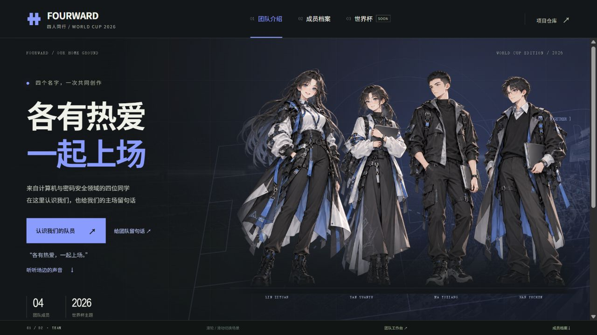
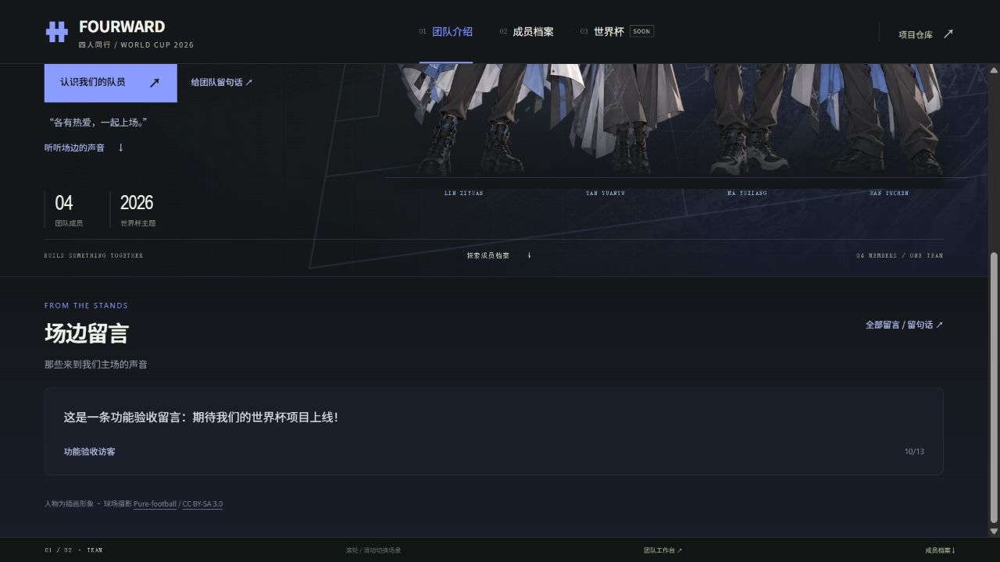

# 2026 世界杯课程设计

互联网数据库开发小组作业，包含团队主页和世界杯两个模块。

在线展示：[NKDEV · FOURWARD](https://acobayashi.github.io/WorldCup2026DB/)。代码协作：[GitHub 仓库](https://github.com/ACobayashi/WorldCup2026DB)。推送到 `main` 后，GitHub Actions 检查原型并自动发布 `public/` 到 GitHub Pages；也可在 Actions 中手动运行。Pages 仅展示静态前端，不运行 PHP 或数据库。

## 完整留言模块本地运行

已经实现访客留言和团队座右铭的 PHP MVC 功能链。访客可给整个团队或某位成员留言，留言写入数据库并默认为待审核，管理员通过后才公开；团队成员登录后可维护自己的座右铭，管理员还可维护团队及所有成员的座右铭。

在仓库根目录执行以下 PowerShell 命令。需要已有 XAMPP，包含 PHP 8.2+、PDO MySQL、mbstring 和 MariaDB 的 Windows 初始化工具。本机实际验证使用 E:\XAMPP 的 PHP 8.2.12 / MariaDB 10.4.32；这不是生产部署命令。

```powershell
powershell -ExecutionPolicy Bypass -File scripts/start-local.ps1 -XamppRoot E:\XAMPP
```

打开 http://127.0.0.1:8088/ ，页面底部的“团队工作台”进入 http://127.0.0.1:8088/admin.php 。本地账号为严苑毓的 `yan-yuanyu`（管理员）及另外三位成员的 slug（成员）。随机密码保存在 `storage/local-accounts.txt`，只用于本地开发，已经从 Git 排除。四位成员的初始座右铭已按本人提供的内容更新，之后可在工作台维护；已存在的数据库不会被初始化脚本覆盖。

脚本使用独立的 `storage/runtime/mysql` 数据目录，数据库端口 3307，Web 端口 8088，均只监听 127.0.0.1。它不会使用已有 XAMPP 的数据目录。重复启动保留账号、留言和座右铭，首次生成的 `.env` 和本地密码文件也从 Git 排除。端口冲突会报错；已有自定义 `.env` 时先按下面的手动配置方式运行。

```powershell
powershell -ExecutionPolicy Bypass -File scripts/stop-local.ps1 -XamppRoot E:\XAMPP
```

正常停止后数据仍保留。换机器时带走代码及所需 SQL/数据备份，重新初始化本地环境；不要复制、提交或公开运行目录及密码文件。

## 手动使用团队数据库

复制 `.env.example` 为 `.env`，填写同一个逻辑数据库的 PDO MySQL DSN、账号、密码和至少 32 字符的随机 APP_KEY。依赖 PHP 8.2+、PDO MySQL、mbstring。先创建空数据库，再在仓库根目录执行：

```sh
php scripts/install.php
php -S 127.0.0.1:8088 -t public public/router.php
```

安装 SQL 使用 CREATE TABLE IF NOT EXISTS 和 INSERT IGNORE，不清空已存在的数据，也不覆盖座右铭；这是初始化脚本，后续结构变更仍需单独迁移。它目前只有 `users`、`team_mottos`、`team_guestbook_messages`、`app_rate_limits` 四张真实业务/公共表，全组最终交付仍需至少 11 张。共享账号表只创建一套；之后选择团队统一框架时，保留模型和功能链，接入公共登录及路由。

创建账号需通过环境变量提供 12–72 字节密码；密码只保存为哈希，不写进安装 SQL：

```powershell
$env:ACCOUNT_PASSWORD = Read-Host '输入本地开发账号密码'
php scripts/create-user.php yan-yuanyu yan-yuanyu admin
Remove-Item Env:\ACCOUNT_PASSWORD
```

成员账号将最后一个参数改为 `member`，账号绑定实际成员 slug。网站根目录应为 `public/`；Apache 可使用其中的 DirectoryIndex 设置，其他服务器请优先指定 `index.php`。此版本采用轻量 PHP MVC 类，未选用第三方框架，尚未验证云端或 Docker 部署。

## 验证

主页与场边留言截图来自本地数据库模式；公开留言按现有审核数据展示。GitHub Pages 使用静态演示模式。





```sh
node scripts/check-prototype.mjs
node --check public/assets/js/app.mjs
node --check public/assets/js/guestbook.mjs
php scripts/check-guestbook.php
```

数据库验收使用事务并最终回滚所有测试数据，覆盖审核可见性、分页、Unicode 长度、文本转义、参数化 SQL、CSRF、角色权限、座右铭编辑和数据库限频。在已初始化的开发数据库上执行。访客留言每个 IP 每分钟窗口最多尝试 5 次，登录每个 IP 每 15 分钟窗口最多尝试 10 次；限频表存储带密钥的摘要，不存原始 IP，也不信任访客自报的代理头。

## 仅预览静态页面

```sh
python3 scripts/serve-prototype.py
```

打开 http://127.0.0.1:5173 。预览脚本固定 .mjs 的 JavaScript 响应类型，避免 Windows 文件关联将其错误地识别成纯文本；不执行 PHP。运行 `node scripts/check-prototype.mjs` 检查初版。

静态预览及 GitHub Pages 保留浏览器本地演示留言，明确标注为本地演示，不能跨浏览器共享，也不运行审核后台。使用 PHP 入口时则调用真实数据库接口，服务故障会显示失败并保留输入，不自动改为本地保存。页面保留独立场景转场、四人档案、人物入场和面部背景动效，成员卡片支持方向键。成员标签根据学院及分工整理，人物形象为插画。主页的“场边留言”展示最新三条团队留言，数据库模式只展示审核通过的内容；全部留言和分页保留在留言弹窗中。世界杯业务仍由其他成员负责，这部分只保留入口。

## Structure

```text
DBDev/
|-- README.md
|-- AGENTS.md                  # 简短贡献指南
|-- .github/workflows/pages.yml # 静态前端自动发布
|-- app/
|   |-- common/                # 公共功能
|   |-- team/                  # 团队主页
|   |   |-- controllers/
|   |   |-- models/
|   |   `-- views/
|   `-- worldcup/              # 世界杯项目
|       |-- controllers/
|       |-- models/
|       `-- views/
|-- config/                    # 配置
|-- public/                    # 网站入口
|   |-- index.html             # 静态演示页面
|   |-- index.php              # 数据库模式主页
|   |-- api.php                # 访客留言和座右铭读取
|   |-- admin.php              # 登录、审核和座右铭工作台
|   `-- assets/
|       |-- css/
|       |-- js/
|       `-- images/
|-- data/
|   |-- install.sql            # 留言模块的四张表与初始座右铭
|   |-- team/                  # 六项正式团队材料
|   `-- personal/              # 个人作业汇总
|       |-- README.md
|       |-- member-a/
|       |-- member-b/
|       |-- member-c/
|       `-- member-d/
|-- scripts/                   # 部署等辅助脚本
`-- storage/
    `-- uploads/               # 上传文件
```

留言模块由 `app/team/models/GuestbookMessage.php`、`MemberMotto.php`、两个控制器和 `app/team/views/guestbook/admin.php` 构成。公共登录、会话、CSRF、PDO 及限频位于 `app/common/`，供后续模块复用；预留空目录仍用 `.gitkeep` 保留。
