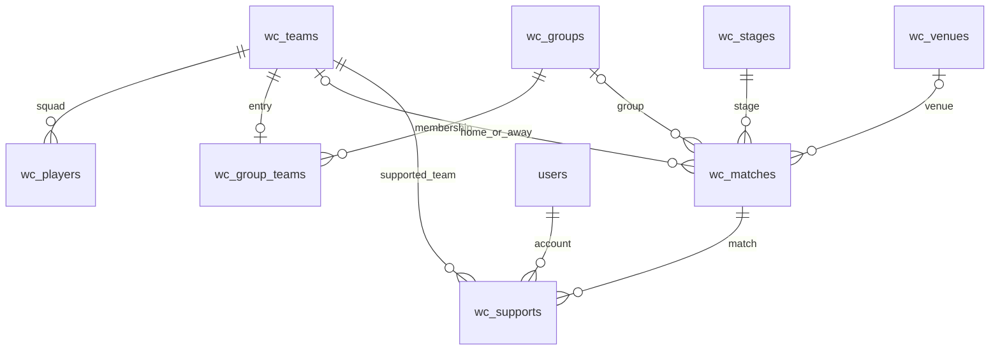

# 世界杯模块框架（第一部分）

这是当前代码的开发参考，不替代最终提交到 `data/team/` 的正式课程材料。范围限定为 2026 年一届赛事，采用现有 PHP MVC/PDO，尚未迁移 Yii2。

## 运行与入口

```powershell
# 本机已安装 PHP/MariaDB 到 D:\WebDev；其他机器传入自己的安装位置。
powershell -NoProfile -ExecutionPolicy Bypass -File scripts/start-local.ps1 -XamppRoot D:\WebDev
# 对已配置的数据库补建新表。CREATE TABLE IF NOT EXISTS 不会升级已存在的表结构。
D:\WebDev\php\php.exe scripts/install.php
D:\WebDev\php\php.exe scripts/check-worldcup.php
```

- `/worldcup/` 或 `/worldcup/index.php`：数据库模式。PHP 内置服务器使用 `public/router.php`；Apache 目录入口使用 `public/worldcup/.htaccess`。
- `/worldcup/index.html`：原有合成数据静态演示，GitHub Pages/静态预览继续使用该文件。
- `/worldcup/?view=matches|teams|groups|venues|support|admin`：六个模块页面。
- `?view=teams&id=球队ID`、`?view=matches&id=比赛ID`：详情。
- `/admin.php`：沿用团队账号登录。成员可以查看自己的支持记录，赛事工作台仅管理员可访问；没有为世界杯新建账号体系。

数据库模式查询失败返回 503，无数据返回空列表；两者不会自动切换到静态示例。本机已导入全量球队、名单和赛程基础数据；支持记录不预置。测试数据只在事务中使用并回滚。导入命令与后续新增表见 [数据库导入说明](../data/worldcup/README.md)。

## 当前能力

已实现：18 张表的初始化与事务式 CLI 数据导入、MVC 分层、只读查询、分页、球队搜索、赛程状态/球队/阶段/小组/北京时间日期筛选、球队阵容与比赛详情、分组名单、场馆列表、自己的支持历史、管理员数据概览、参数校验、统一接口错误、共享登录和 CSRF 边界。

待后续独立提交：详细数据页面接入、后台增改及审计、支持新增/改选/取消、小组积分和同分排序、完整部署和课程交付材料。当前所有编辑按钮禁用，支持 POST 接口在登录及 CSRF 检查通过后返回 501，不产生写入。

## 数据表与关系

完整 DDL（字段类型、注释、索引和约束）统一位于 `data/install.sql`。

| 表 | 关系与职责 |
| --- | --- |
| wc_teams | 球队代码唯一，保存中英文名称、本地队徽路径、来源链接和采集时间 |
| wc_players | team_id → wc_teams；本届阵容，同队非空球衣号码唯一 |
| wc_venues | 名称/城市/国家组合唯一，时区为 IANA 标识，保存资料来源 |
| wc_stages | 阶段代码唯一，名称、顺序、是否小组赛 |
| wc_groups | 小组代码唯一，名称及展示顺序 |
| wc_group_teams | group_id → wc_groups，team_id → wc_teams；每队本届最多属于一个小组 |
| wc_matches | 关联阶段、小组、双方球队和场馆；比赛编号唯一，来源提供方与来源编号组合唯一 |
| wc_supports | user_id → users，match_id → wc_matches，team_id → wc_teams；每用户每场最多一条记录 |



关键语义：

- 数据表为 InnoDB、utf8mb4；数字主外键 BIGINT UNSIGNED；所有 DATETIME 按 UTC 存储，页面以北京时间展示。
- 比赛对阵未确定时球队 ID 可以为空，`home_slot`/`away_slot` 保存名额说明，不创造虚构球队。
- `home_score_90`/`away_score_90` 是常规时间比分；`home_score_et`/`away_score_et` 是加时结束的**总比分**；`home_penalty_score`/`away_penalty_score` 单独记录点球。未知分数为空，0 表示已知零进球。
- 对外比赛数据中的 `home_score`/`away_score` 优先取加时总比分，否则取常规比分，均不累加点球。
- 状态为 scheduled/live/finished/postponed/cancelled，不根据“时间已过”直接推断比赛结束。
- `support_closed_at` 表示已经关闭；后续改期开球时间不应自动重开支持。
- 支持票数从 `wc_supports` 聚合查询，不持久化百分比，不设置虚构初始票数。
- 外键阻止直接删除仍被引用的球队、场馆、比赛或账号，后续后台应先设计下架及关联处理。
- 后续写入服务仍须在事务中校验：小组与阶段匹配、双方球队的小组归属、支持球队属于该场双方、未开赛且支持未关闭；这些跨表规则尚无可用的写入路径。
- 导入器负责核对来源、队伍代码、IANA 时区、来源唯一键及业务状态。来源链接当前只按文本输出，不执行或直接用作不受限图片地址。

## JSON 接口

当前使用 `/worldcup/api.php?action=...`；未来 `/api/v1/...` 是 README 中的迁移目标。不会修改团队留言接口的 `{ok,data,error}` 合约。

成功响应：`{"code":"OK","message":"","data":{},"errors":null}`。

失败响应：`{"code":"HTTP_422","message":"参数说明","data":null,"errors":null}`，同时设置对应 HTTP 状态。未知内部异常返回 503/UNAVAILABLE，不暴露 SQL 或凭据。

| action | 方法 | 参数/内容 |
| --- | --- | --- |
| bootstrap | GET | 脱敏当前账号、csrf_token、能力开关 |
| overview | GET | 八张业务表的记录数和能力开关 |
| teams | GET | q；分页 |
| team | GET | id 必填 |
| players | GET | team_id 必填；分页 |
| matches | GET | status、date、team_id、stage_id、group_id；分页 |
| match | GET | id 必填；含双方名称、显示比分及数据库支持票数 |
| groups | GET | 分页；每个小组包含 teams 名单，不含未经实现的积分榜 |
| venues / stages | GET | 分页 |
| my_supports | GET | 需要登录；分页；仅当前账号的记录 |
| admin_overview | GET | 需要 admin；数据概览 |
| support | POST | 预留；需登录及 X-CSRF-Token 请求头（也支持表单 csrf）；校验后返回 501 |

分页参数 `page` 默认 1，`page_size` 默认 20、最大 100，返回 `data.items` 与 `data.meta`。`meta` 包含 page/page_size/total/total_pages。`date` 是严格 YYYY-MM-DD 的北京时间自然日，查询会转换为 UTC 的左闭右开区间。比赛时间字段传输为带 Z 的 ISO 8601。当前球队、阵容、场馆和个人支持记录中的时间字段为 UTC 数据库格式。

## 后续分工边界（尚未分配人员）

| 功能边界 | 现有入口 | 后续工作 |
| --- | --- | --- |
| 球队与阵容 | models/Team.php、Player.php；controllers/TeamController.php；views/teams.php | 真实资料、后台维护、队徽资源 |
| 赛程与结果 | models/MatchModel.php；controllers/MatchController.php；views/matches.php | 数据导入、赛果维护、状态与比分校验 |
| 分组与场馆 | models/Catalog.php；controllers/CatalogController.php；views/groups.php、venues.php | 资料维护、积分与同分排序；扩展时可拆分独立模型 |
| 支持投票 | models/Support.php；controllers/SupportController.php；views/support.php | 数据库事务、截止判断、唯一约束冲突处理、改选和取消 |
| 工作台 | controllers/AdminController.php；views/admin.php | 共用登录的后台编辑、审计和导入入口 |

以上路径相对 `app/worldcup/`。公共分页查询和参数校验分别集中于 ReadModel、ReadController。成员领取功能时同时承担该功能的 M/V/C 文件，保留个人 Git 提交证据；当前框架不代表已经满足全体成员的个人 MVC 贡献要求。

## 验证

`scripts/check-worldcup.php` 使用事务并最终回滚测试数据，覆盖约束、分页、搜索转义、北京时间日期边界、比分语义、数据库票数、用户隔离、权限、CSRF、未实现写入的 501、页面转义及清理。运行前应先安装表结构；只用于开发数据库。
